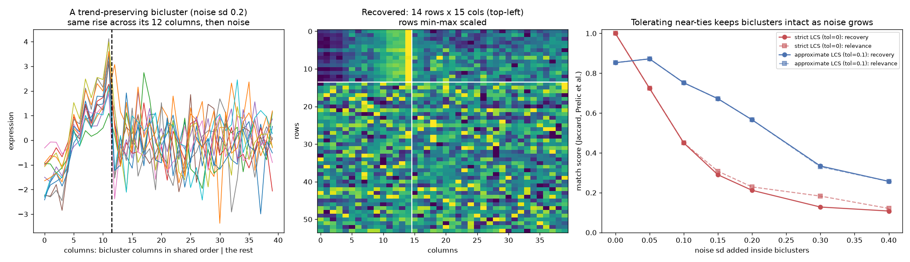

# Noise-Tolerant Biclustering

> Thirty genes rise together across twelve of your forty samples. A whole-matrix clustering will never see them.

## Demo Output

Produced by `demo.py`. Three trend-preserving biclusters are planted in a 240 x 40 noise matrix. Left: one bicluster's rows. Middle: what the approximate method recovers. Right: recovery as noise grows, strict vs approximate LCS.

## Why This Exists

Gene modules are often active in a *subset* of samples: a pathway switched on in some tumours, a programme in some cells. Biclustering looks for row-and-column subsets at once. "Trend-preserving" biclusters are the most biologically natural kind: the genes rise and fall in the same order across the shared samples, even when their scales differ.

The classic trick (UniBic) is to sort each gene's samples by expression and find the longest common subsequence (LCS) of two genes' sample orders. But noise swaps near-equal values, and one swap breaks the chain. NoiBic (Long et al., *Bioinformatics* 2026) replaces LCS with a longest *approximate* common subsequence that tolerates swaps between similar values. It then adds noise-aware expansion steps.

## How It Works

1. **Normalise** each row to [0, 1].
2. **Approximate LCS.** Values within `tol` of each other count as ties, so two genes' shared trend becomes a longest non-decreasing chain. That chain is found in O(m log m) by patience sorting. `tol = 0` gives the classic strict LCS.
3. **Seeds.** Score every row pair inside random row groups, as NoiBic does, and take the pairs with the longest shared trend.
4. **Grow rows.** Add rows in order of their similarity to the seed, pruning columns to the trend all rows share. Stop when the bicluster's smaller side would shrink.
5. **Noise-aware expansion.** Insert a column if, in at least 85% of rows, it falls at the same place (±1) in the shared order. Add a row if its chain covers at least 85% of the columns.
6. **Score** with Prelić recovery and relevance: Jaccard overlap of matrix cells with the planted biclusters.

## What the Demo Shows

| Noise sd | Strict LCS recovery | Approximate LCS recovery |
|----------|---------------------|--------------------------|
| 0.00 | **1.00** | 0.85 |
| 0.10 | 0.45 | **0.75** |
| 0.20 | 0.21 | **0.57** |

Tolerance has a cost. On noise-free data it merges some background ties and loses a little precision. Once neighbouring values swap, the strict method falls apart.

## A Simplification to Know About

NoiBic allows a swap only when the four values involved are similar *relative to each row's coefficient of variation*. It also scores the cost of each swap. This repo uses a simpler rule, rounding each normalised row to steps of `tol`, which gives the same behaviour in a few lines. Its C++ implementation is at github.com/lcyi0208/NoiBic.

## When NOT to Use This

- **Constant-level biclusters** (a block that is simply "high"). Plain thresholding or spectral biclustering is simpler there.
- **Very wide matrices.** All-pairs seeding costs O(n²) per row group. For scRNA-seq, first select highly variable genes, as the paper does (top 2,000).
- **As evidence on its own.** A bicluster in noise is still a hypothesis. Check it in held-out samples, or test its genes for enrichment.

## The Uncomfortable Truth

Every biclustering method finds *something* in pure noise. Among tens of thousands of random row pairs, some share a long trend by chance. Always run the method on a row-shuffled copy of your matrix. If it finds biclusters just as large there, your "modules" are noise.

## Further Reading

- Long C. et al. "NoiBic: a noise-tolerant biclustering algorithm for high-throughput gene expression data analysis." Bioinformatics (2026). doi:10.1093/bioinformatics/btag743
- Wang Z. et al. "UniBic: Sequential row-based biclustering algorithm for analysis of gene expression data." Scientific Reports (2016).
- Prelić A. et al. "A systematic comparison and evaluation of biclustering methods for gene expression data." Bioinformatics (2006).
- Ben-Dor A. et al. "Discovering local structure in gene expression data: the order-preserving submatrix problem." Journal of Computational Biology (2003).
